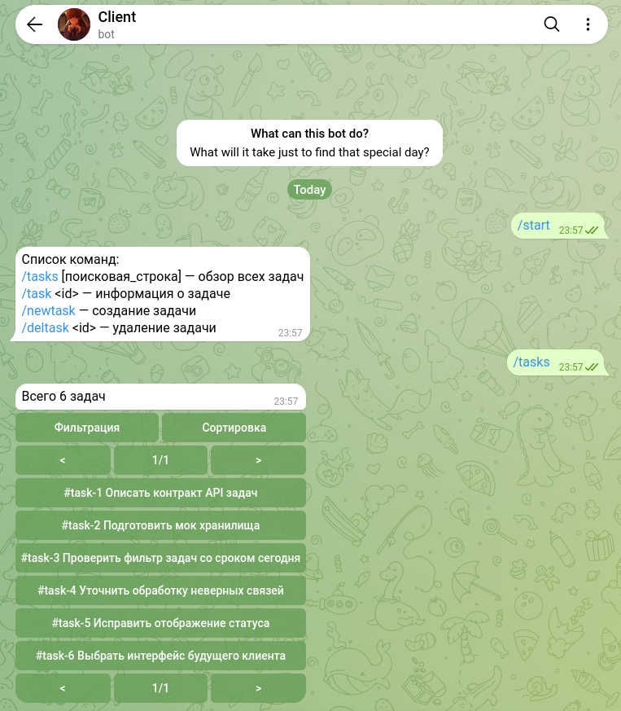

## Что здесь будет?

После активации бота через `/start` вылетит приветственное сообщение с описанием основных команд (контекстов? режимов работы? хз как это назвать). Среди них будут:

- `/tasks [поисковая_строка]`  

  - [x] позволяет обзорно просматривать все задачи;
  - [ ] результаты поиска по номеру или строке
  - [x] выводит сообщение вида «Всего 200 задач»;
  - [x] в первой строке кнопки сортировки, во второй кнопки фильтрации
  - [ ] фильтрация и сортировка со своими подменю для выбора аргументов
  - [x] например, штук по 10 можно листать сами кнопки-задачи вида «#123 Заголовок, насколько он помеща…», ограниченные по максимальной ширине кнопок;
  - [x] (увы, нельзя на уровне API) можно статус или тип можно показывать цветом кнопки
  - [ ] тык по задаче переходит к контексту `/task`;
  - [ ] сделать по умолчанию задачи только для текущего пользователя.

  Пока выглядит следующим образом:

  

- `/task <#номер>`  

  Выводит всю информацию о задаче, позволяет поменять некоторые поля. Ссылка на исполнителя в телеге. Связанные задачи, наверное, всё-таки просто списком в сообщении (кликабельно с вызовом `/task`). Насчёт полного редактирования — наверное, пока не нужно.

  Кликабельно не получится, но можно подставить текст в поле ввода сообщения вроде `/task task-1`

- `/newtask`  

  Интерактивно проводит пользователя по заполнению всех полей.

- (?) `/deltask`  

  Нужно ли пакетное удаление (по маске или фильтру) — хз. Можно встроить этот функционал в контекст `/task`. Но удаление задачи в целом — это нехорошо. Пусть лучше просто выполненными будут (архивными).

Не уверен насчёт авторизации, возможно, стоит просто хранить в базе данных ID пользователей, которые имеют право изменять или просто просматривать задачи и менять статус (допустим, статус может менять только исполнитель).

Пока не буду упарываться в эмодзи и прочую ерунду на кнопках и в тексте.

## Локальный кэш

Нажатие на любую кнопочку будет каждый раз делать API-запрос (например, при пролистывании страниц с задачами). Будет ли при этом каждый раз происходить обращение к базе данных — зависит от реализации API. Но со стороны клиента никакого кэша ответов от сервера точно не будет. Иначе придётся хранить его отдельно для каждого пользователя. Допущение, так сказать.